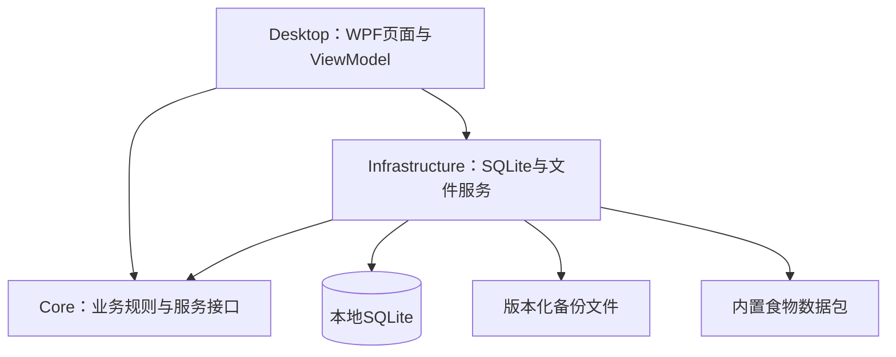

# 架构与技术设计

用途：规定软件实现边界及后续升级方式。状态：2026-10-22 已交付1.4.0，三个生产项目、归档源码重建及版本回滚通过验证；详细证据见开发进度。产品范围见 [需求说明](requirements.md)。

## 1. 技术选择

| 组件 | 已选方案 | 选择理由 |
|---|---|---|
| 语言与运行平台 | C#、.NET 10 LTS | 面向明确的Windows平台，使用受支持的长期支持版本；SDK具体补丁版本在环境准备时核实并固定 |
| 桌面界面 | WPF、XAML、MVVM | 适合表单、列表、数据绑定和Windows桌面操作；将界面状态与业务逻辑分开 |
| 存储 | SQLite、Microsoft.Data.Sqlite | 无需服务器，适合单人离线数据；参数化SQL、事务和显式迁移便于验证 |
| 备份格式 | System.Text.Json、版本化JSON | 完整备份使用标准序列化，允许逐字段校验和未来升级 |
| 验证 | .NET测试项目、真实SQLite集成测试、Windows界面实际操作 | 分别验证规则、持久化和产品操作流程；测试框架版本在准备阶段锁定 |
| 分发 | win-x64 self-contained文件夹压缩包 | 包含所需.NET运行时；解压后启动，不要求用户另装开发环境 |

官方资料：WPF是Windows专用界面框架，具备布局和数据绑定；Microsoft.Data.Sqlite可独立用于访问SQLite；.NET 10的官方支持截至2028-11-14。自包含分发需要随应用重发运行时安全更新。上述事实已于2026-10-21核对：[WPF](https://learn.microsoft.com/en-us/dotnet/desktop/wpf/overview/)、[SQLite提供程序](https://learn.microsoft.com/en-us/dotnet/standard/data/sqlite/)、[.NET支持周期](https://dotnet.microsoft.com/en-us/platform/support/policy/dotnet-core)、[发布方式](https://learn.microsoft.com/en-us/dotnet/core/deploying/)。

这是基于Windows专用、离线单人需求的工程选择。后续若增加手机同步，需单独评审数据同步与客户端方案，不把当前桌面界面视为自动跨平台。

## 2. 模块和依赖

桌面启动入口负责组装依赖。ViewModel只调用用例服务，不直接执行SQL。Core只依赖.NET基础库；Infrastructure实现Core定义的存储与备份接口。三个生产项目加测试项目足够，不引入网络后端、通用插件系统或微服务。

当前实现用`JournalService`集中处理摄入、汇总、食物搜索维护及餐次，通过`IJournalStore`访问存储；`BackupService`处理完整备份恢复，`SqliteJournalStore.Initialize`检查应用标识、初始化和结构版本。构造函数注入依赖，事务边界围绕一次完整写操作。当前规模不额外建立只有转发调用的服务类。

1.2界面使用`App.xaml`集中维护颜色与控件样式，`MainWindow.xaml`组织四页布局；表单内容滚动而保存区域固定。导航模板保留`PART_SelectedContentHost`供辅助技术访问内容，选中文字颜色只作用于导航标题。空白状态及历史未记录样式直接绑定现有集合与记录数，不修改业务计算或存储。

1.3导入使用Core中的`IntakeTextParser`和`ImportPlanner`产生与校验草稿；复制表格由.NET标准库`TextFieldParser`处理引号、分隔和换行。独立`ImportWindow`/`ImportViewModel`负责核对与确认，调用`BackupService.CreateImportBackup`后由`JournalService.ImportEntries`和存储的`AppendEntries`在单个事务中追加；不覆盖旧条目，不改变结构版本。具体边界见[历史记录导入](历史记录导入.md)。

1.4连续列表位于每日页面右侧，与单日视图共享左侧摄入表单。`JournalService.BrowseDays`一次读取区间明细，按日期倒序组织每天的有序摄入与合计；不增加存储表和缓存总数。`MainViewModel`用独立的已应用查询区间维护列表，失败的筛选不影响保存后的刷新；每次摄入写入、恢复或导入后同步刷新。列表采用有界区间与日期容器虚拟化，鼠标滚轮交给外层列表，避免嵌套表格截断滚动。列表按钮传递明确的日期或摄入对象，复用现有确认、编辑和删除逻辑，保留食物与导入来源快照。

## 3. 计划目录

| 路径 | 职责 |
|---|---|
| `src/CalorieJournal.Desktop/` | App启动、Views、ViewModels、Styles；界面状态和命令 |
| `src/CalorieJournal.Core/` | Models、Services、Validation、Interfaces；计算、校验和用例 |
| `src/CalorieJournal.Infrastructure/` | SQLite存取、版本迁移、备份与食物包加载 |
| `tests/CalorieJournal.Tests/` | 业务和真实数据库集成测试 |
| `data/builtin/` | 可分发食物包、来源清单、版本和校验信息 |
| `scripts/` | 可重复构建、测试、打包和食物数据整理入口 |
| `docs/` | 需求、设计、进度、验收与数据来源 |
| `workspace/` | 忽略管理的下载原始档案、独立测试数据和中间文件 |
| `artifacts/` | 忽略管理的测试输出和发布包 |
| `.tools/`、`.nuget/`、`.dotnet-home/` | 项目隔离工具和缓存 |

目录随阶段需要创建，不提前建立空目录。`global.json`固定SDK，NuGet依赖及锁文件记录实际核实的版本。

## 4. 核心数据模型

数据库结构版本独立于应用版本；所有主键使用稳定ID。下表对应当前实现的逻辑模型；SQL结构在`SqliteJournalStore.cs`维护，数据库同时使用应用标识与版本号拒绝无关库或不兼容写入。

| 实体 | 关键字段及意义 |
|---|---|
| `FoodItem` | `Id`；`Name`中文名称；`OriginalName`原名；`Aliases`别名；`Preparation`生熟/加工状态；`Category`分类；`KcalPer100gHundredths`每100克大卡×100的整数；`SourceKind`来源类型；`SourceId`、`SourceVersion`、`SourceUrl`；`SourceNote`用户来源说明；`BuiltinKey`内置包稳定键；`UserModified`；`IsDeleted`；`CreatedAtUtc`、`UpdatedAtUtc` |
| `MealCategory` | `Id`、`Name`、`SortOrder`、`IsActive`；初始早餐/午餐/晚餐/加餐，有引用时不能级联删除 |
| `IntakeEntry` | `Id`；`EntryDate`记账日期；`LocalTime`可选HH:mm；`MealCategoryId`；`MealNameSnapshot`；`FoodId`可空；`FoodNameSnapshot`；`PreparationSnapshot`；`InputMode`直接/按重量；`WeightGramsTenths`可空，克×10；`KcalPer100gHundredthsSnapshot`可空；`SourceSnapshot`来源标识和用户修改标记；`EnergyKcalTenths`最终大卡×10；`Note`；创建及修改时间 |
| `AppMetadata` | 数据库版本、已应用内置包版本、首次初始化完成标记及必要设置；不保存可由明细计算的每日总数 |

数值统一使用64位整数持久化。Core采用decimal计算并集中校验；每项大卡按`MidpointRounding.AwayFromZero`保留一位。手动直接录入时重量与单位热量为空；按重量录入时两者必填且满足需求范围。

日期保存`yyyy-MM-dd`，操作时间保存UTC；操作时间不决定该项归属哪天。按日期、餐次建立索引；首版读取当前食物库后按中文名、原名、别名、分类及状态进行多词筛选，列表使用WPF虚拟化。60项实际食物库的性能已检查；今后数据增长时再评估存储层搜索与分页。

食物删除采用保留删除标记的方式实现用户可见删除，摄入快照不依赖食物继续存在。用户编辑内置食物时保留原来源并标记“用户修改”，不能继续把改动后的数值显示为来源原值。

## 5. 必要接口

| 接口/用例 | 输入与输出 | 约束 |
|---|---|---|
| `CalculateEnergy` | 重量、单位热量 → 定点结果 | 统一校验范围、换算和舍入 |
| `CreateIntake` / `UpdateIntake` | 录入字段与快照 → 持久化条目 | 保存前完成校验；编辑不得隐式刷新食物快照 |
| `DeleteIntake` | 明细ID → 成功或明确失败 | 界面先确认；仅删除指定条目 |
| `GetDay` / `GetDateRange` | 日期/区间 → 明细、分餐与每日汇总 | 排序确定；空白日期明确表示未记录 |
| `SearchFoods` | 搜索词、页码 → 食物摘要 | 默认排除已删除条目；名称、原名、别名可搜 |
| `SaveFood` / `DeleteFood` | 条目字段/ID → 结果 | 用户修改状态持久化；历史不变 |
| `ExportBackup` | 目标路径 → 备份结果与条目数 | 一致性读取，标准序列化，完成前不显示成功 |
| `InspectBackup` / `RestoreBackup` | 备份路径、用户确认 → 校验摘要/恢复结果 | 拒绝未知格式；替换前备份；事务导入 |

服务错误带可理解的消息和技术类别；输入错误、文件不可写、数据库损坏和版本不兼容分别处理。只在边界处理可说明的错误，不能吞掉异常继续显示成功。UI长操作提供忙碌状态，提交期间禁用重复操作。

## 6. 存储、备份与更新

- 生产数据建议位于`%LOCALAPPDATA%\CalorieJournal\`；开发测试显式指定项目`workspace/`下独立目录。程序包路径变化不能改变用户数据定位。
- 首次启动在事务中建库并导入审核通过的食物包；成功后写入初始化标记。失败则显示原因，不进入只有部分数据的正常界面。
- 同一Windows用户限制单实例写入；数据库开启外键，所有SQL参数化；常规数据量先使用默认事务机制，未验证前不增加额外并发设计。
- 完整备份使用`*.calorie-backup.json`，包含格式版本、应用/数据库/食物包版本、导出时间、全部食物（含用户删除标记）、餐次、摄入快照和必要元数据。不包含机器绝对路径。
- 备份序列化到目标目录的专用暂存文件，完整刷新后原子移至目标文件名；导出要求新文件名，不覆盖已有备份。
- 恢复前限制文件大小、解析深度与记录数量，校验版本、主键唯一性、引用、数值与日期结构；先展示替换范围并确认，再生成现有数据备份。备份失败即停止恢复。
- 恢复为全量替换，不隐式合并。校验完成后以一个数据库事务写入；失败回滚，保留旧库。恢复按保存时的数据验证，不因为时钟变化或今天日期而拒绝合法历史档案。
- 软件升级使用独立版本目录，数据库迁移前生成完整备份；迁移按版本顺序执行，事务提交后才更新版本号；遇到比程序更新的数据库拒绝写入。未来每次结构变化须附迁移及升级前后验证。
- 内置包升级只自动新增从未出现的稳定键；已存在、用户修改或删除的条目均保持不变。包修订值的手动比对导入可未来另行设计，当前不隐式覆盖旧值；界面保留每项实际来源版本。
- 首版手动更新发布包；维护流程检查运行时和依赖安全更新后重建并验证。卸载程序不删除用户数据；数据清理需要用户单独选择。
- 每个稳定版本在`artifacts/releases/<version>/`独立归档程序压缩包、源码快照、依赖锁文件、校验与版本清单、变更说明和回滚入口。包含真实用户内容的数据备份保存在用户数据目录或用户指定位置，与可分享发布包分开。
- 返回上一版前检查数据库与备份兼容性：格式兼容时切换独立程序目录；格式不兼容时先生成当前库的一致性归档，再预览升级前备份的时间和恢复影响，经明确确认后恢复旧版可用的数据库。不得直接复制旧exe并让其写入新结构。
- 数据库归档使用SQLite备份机制或已验证的一致性导出，不直接复制正在写入的数据库文件。回滚失败保留两版程序及两份数据归档；每个后续稳定版本须在独立测试目录完成升级、回滚、再次升级验证，详见 [版本迭代与回滚](版本迭代与回滚.md)。

## 7. 可扩展性与验证边界

首版通过验收后，用户已授权按实际需要增加锻炼、减脂管理、菜谱等简洁功能及质量改进。新增能力使用独立用例和页面，保持摄入快照语义，通过迁移管理必要新增字段或表；运动消耗不隐式抵扣已记录摄入。具体后续版本选择及验收记录在 [版本迭代与回滚](版本迭代与回滚.md)，当前不提前建立未进入实施的表或插件框架。

当前构建、真实SQLite测试、独立STA绑定与焦点布局、自包含候选包及桌面操作已通过；命令行与系统文件对话框备份恢复、候选版本往返回滚已实际运行。当前环境为150%系统DPI；其他DPI的跨显示器切换及另一台干净Windows环境未执行，详见 [开发进度](progress.md) 和 [运行与验证](运行与验证.md)。
