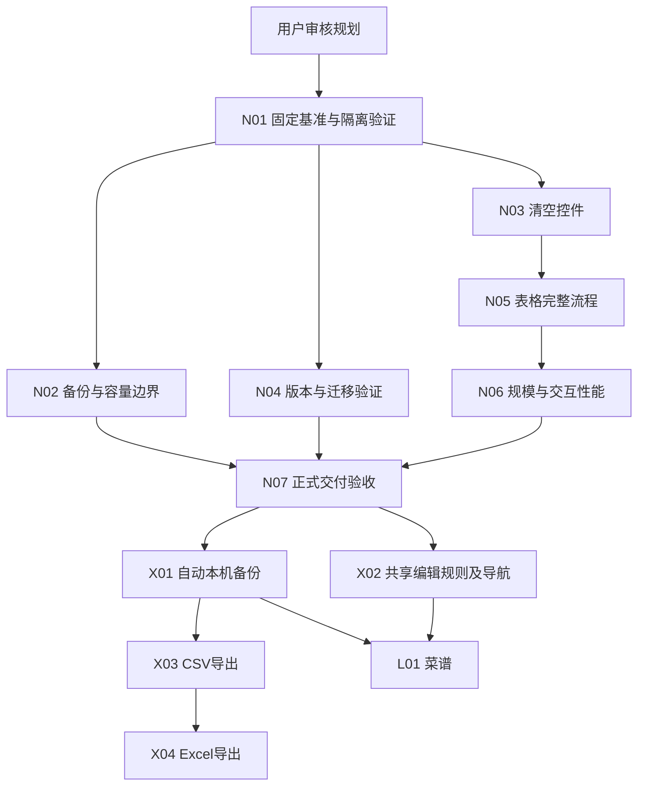

# 新开发路线图 V2

日期：2026-10-24。状态：**用户已批准，按N01起的优先级实施。** 用户已明确X05增加体重及腰围趋势图。实际完成状态统一见[开发进度](../progress.md)；历史评估结论及当时验证边界保留。

依据：[项目现状](PROJECT_REASSESSMENT.md)、[问题及改进方案](IMPROVEMENT_PLAN.md)、[待确认事项](OPEN_QUESTIONS.md)。问题编号A01–A12用于追溯，以下任务编号独立于旧计划的I1–I7。

## 1. 目标与执行边界

目标是让现有单人本机软件更可靠、更容易记录和维护；保持历史快照、明确单位、缺失/零区分及运动独立。保留三个生产项目、既有稳定程序和回滚路径。新表格与旧表单都保留，默认页不擅自改变。

1.12.0继续作为当前稳定基准；1.13.0是已有开发工作，不因版本号已经写入源码而取得发布资格。实施开始时重新核对用户指示、Git状态、正在运行的程序与文件变更，不清理或覆盖现有36项修改。

后续功能版本号在进入交付阶段时确定。旧计划中的“菜谱1.14、导出1.15”是历史排期，不是必须兑现的版本号；不得覆盖已存在的标签或包。必要时可独立安排稳定版补丁，但必须先确定来源、隔离未验收表格工作并完成对应验证，不能把开发中代码直接推为修复版。

## 2. 优先级与依赖

| 层级 | 工作 | 进入/退出条件 |
|---|---|---|
| **Now：稳定化与当前需求交付** | N01–N07：测试身份、备份边界、清空控件、版本检查、表格完整行为、性能测量、正式验收 | 用户批准规划后开始；退出时无未解决P1，当前功能及数据回退有对应产物证据 |
| **Next：长期使用和维护** | X01自动备份；X02共享编辑规则/导航；X03 CSV、X04 Excel；X05身体趋势按确认范围 | 各自前置条件通过后开始，独立小版本验收；不是一次大改 |
| **Later：扩展及持续审核** | L01菜谱；L02中文语义抽查；L03按需求评审文件识别；L04偏好兼容设计的后续实现 | 菜谱须有稳定录入和备份基础；资料抽查可小批进行；未确认新范围不实施 |

图中并列表示没有必然代码依赖，不代表要求并行修改文件。默认一次完成一个可审查任务；不自动创建子任务线程或代理。

## 3. 阶段一：固定基准并修复交付前问题（Now）

### N01：建立可追踪且独立的验证运行

- **目标/必要性：** 对应A05/A09，区分稳定源码、工作区源码和现存编译产物，避免复用残留结果。
- **优先级/依赖：** P1基础工作；依赖规划审核。
- **范围/交付：** 保存当前变更清单；构建使用独立输出目录，保护运行中的应用；为每次测试分配独立目录、运行ID、源码/程序集/锁文件哈希。当前WPF需要前序数据时显式传递本次fixture，不按任意目录时间选择。修订当前状态入口并保留历史记录。
- **完成标准：** 新建空运行目录可执行完整检查；失败报告标明失败阶段与未执行项；测试输出不会覆盖原报告或真实资料；当前源码重新构建与已有79项结果可以明确区分。
- **验证：** 单功能和完整入口分别运行，另一次运行不能误用前一次文件；核对Git与锁文件；不新增mock。
- **估计/风险：** 1–2人日，中等风险；先完成运行隔离，不为拆分测试重写全部用例。

### N02：保证应用产生的数据始终可备份恢复

- **目标/必要性：** 对应A03/A04，修复读取大小、合法写出及记录总量之间的不一致。
- **优先级/依赖：** P1，依赖N01。
- **范围/交付：** 统一并说明容量策略；备份写出回读校验；所有新增入口在事务中执行一致数量约束；已有超限库的保全出口。升级、恢复和未来自动备份共用已验证机制。
- **完成标准：** 合法支持范围的数据可导出、校验并恢复；不可读前置备份阻止替换；达到数量上限时已有记录仍可编辑/删除/导出，不部分写入；备份和旧程序兼容范围明确。
- **验证：** 用明确测试输入、真实SQLite/JSON执行边界前/边界/边界后、长来源/备注、超50MB、占用文件、事务故障；新旧库逐项比较。大规模测试记录来源、数量、耗时、内存，数据不伪装为真实饮食记录。
- **估计/风险：** 3–5人日，高影响范围；可按“容量规则→写出回读→入口一致性”分三次审查，但完成标准不可删减。

### N03：完成共享清空控件行为

- **目标/必要性：** 对应A01，解除当前WPF失败并满足用户一键清空要求。
- **优先级/依赖：** P1，依赖N01。
- **范围/交付：** 定位真实输入与自动化时序，最小化修复可执行性；验证绑定、撤销、焦点、中文输入法、只读及禁用。提供失效条件和修复后的复现记录。
- **完成标准：** 同一控件反复输入/清空/Undo/Redo有效，搜索和预览随之变化，已存记录不被自动删除，Tab顺序不因清空按钮改变。
- **验证：** 真实WPF命令以及实际鼠标、键盘；经典页、表格页、库搜索与多行文本覆盖。
- **估计/风险：** 0.5–2人日；共享样式需要相关窗口回归。

### N04：统一发布版本事实及迁移检查

- **目标/必要性：** 对应A02/A08，消除程序8/清单7/测试1–6的不一致。
- **优先级/依赖：** P1，依赖N01；正式回滚依赖N02。
- **范围/交付：** 可核验的程序版本能力输出、清单一致性检查、实际旧版本迁移矩阵、每版唯一证据清单。暂保留结构8及严格拒绝旧版写入；单独记录未来界面偏好的兼容取舍。
- **完成标准：** 包内程序、manifest、导出备份和验证报告版本一致；旧结构7营养列按存在验证；故意不一致的包不能进入稳定发布。
- **验证：** 使用真实旧程序及其测试库，执行结构1–7→8；备份失败/事务失败保护；8→7→8必须先完整归档并指定结构7旧恢复点，返回新版九类数据及设置一致。
- **估计/风险：** 1–3人日；旧包、旧标签和历史脚本不更改，不能用新程序伪造旧库替代演练。

阶段一退出条件：N01–N04已通过，任何备份/保存/元数据P1没有遗留。尚未证明表格完整可用时仍不得发布1.13稳定版。

## 4. 阶段二：完成新表格及交付资格（Now）

### N05：完成双页面表格记录的实际使用流程

- **目标/必要性：** 用户最新功能需求，覆盖R36–R41尚未执行的部分，不用“已有代码”作为完成依据。
- **优先级/依赖：** P1，依赖N03；使用N01运行隔离。
- **范围/交付：** 设置最后、页面切换持久化；日期→餐次→行；新增行可见并便于开始输入；名称中文/英文/别名联想；逐行保存/取消及详情；两种录入、kJ、蛋白质、份量、来源和三种入库策略。
- **完成标准：** 空行不入库/不计总量；多个草稿切换后保留；重复保存不重复；日期/餐次移动、食物变化、删除及失败不会重算旧快照或丢草稿；点击直接能量框切换模式；旧页功能保持。关联名称修改后明确转手动。保存结果同步当日、历史、统计和目标比较。
- **验证：** 真实SQLite与WPF，候选键盘/鼠标、无匹配/清空/取消、所有入库策略、失败重试、重启、备份恢复；920×600和既有缩放档下操作可达，横向/纵向滚轮及焦点实际检查。人工桌面流程需核对对应已保存数据库结果。
- **估计/风险：** 2–4人日，中等；必须跑到整套新增检查末尾，不能只修第一条失败后宣布通过。

### N06：量化表格与搜索性能并按证据修复

- **目标/必要性：** 对应A06，确认新编辑方式在长期数据规模下可用。
- **优先级/依赖：** P2、交付前验证项；依赖N05基本流程。
- **范围/交付：** 记录30/366天、食物60项及公开目录规模、摄入1千/1万/支持上限的耗时、连接次数和内存；仅修复测得的瓶颈，优先一次读取上下文和正确缓存失效。
- **完成标准：** 常用保存/查询/搜索达到原300ms目标或明确可验证的适用规模；规模上限操作无不可恢复冻结、无草稿丢失；任何保留限制不能掩盖基本录入失败。
- **验证：** 多次冷/热运行、p50/p95和最大值；键盘连续输入与旧候选回到页面时核对正确性；重新编辑旧记录确认快照未变化。
- **估计/风险：** 1–3人日；未测量前不承诺速度，也不为提前优化引入服务器或额外数据库。

### N07：源码、程序、环境及回退的正式验收

- **目标/必要性：** 对应A09/A10及用户每版保留回滚的要求。
- **优先级/依赖：** P1发布门槛；依赖N02/N04/N05/N06。
- **范围/交付：** 新候选包、独立源码锁定重建、完整业务/WPF报告、自包含包验证、真实升级回退、当前说明与脱敏证据。增加干净Windows与空缓存重建的资格检查；没有环境时按OPEN_QUESTIONS明确状态。
- **完成标准：** 测试对应最终包和源码；无P1；新设置、营养、九类集合在实际往返中保持；所有旧稳定ZIP不变；环境未验证项明确，不能伪称全环境通过。是否接受环境限制进入稳定发布由用户审核该限制后决定。
- **验证：** 正式归档重新构建及运行；清单哈希、源码/程序集版本；恢复缺少/损坏旧点时保护；干净系统核心流程；至少既有150%环境及可用跨DPI场景；私密文件排除。
- **估计/风险：** 1–3人日，另受环境可用性影响；不得覆盖旧包重封，也不能仅复制旧EXE视为回滚。

阶段二退出条件：当前功能形成独立可用版本，证据和产物可对应。用户审核允许继续实施后，沿用长期授权，在全部相应检查通过后提交推送、附注标签及公开Release；本轮评估不执行这些动作。

## 5. 阶段三：长期使用与局部维护（Next）

| 任务 | 目标、范围及交付 | 优先级/依赖 | 验收与验证 | 估计与主要风险 |
|---|---|---|---|---|
| X01 自动本机备份 | 按成功写入触发、可配置保留、最近可读副本、独立恢复点；在设置显示最后成功/失败状态 | P2最高；N07、N02 | 默认当天首次成功写入及后续间隔遵循经审核规则；没有成功新副本前不删除最后可用副本；备份失败不把已经提交的记录报成保存失败；真实轮换、占用失败、重启和完整恢复；只运行期间执行 | 2–4人日；节流、轮换删除和故障反馈须逐项检查 |
| X02 共享编辑规则与稳定导航标识 | 在两个入口之间复用数值转换、快照组装和来源标记；页面使用稳定标识；不整类重写 | P2；N05/N07行为基准 | 相同输入两入口生成相同业务快照；取消/失效输入/食物改变仍正确；页面重排不需修改多个数字分支；不修改数据版本 | 2–4人日；每项规则小改并实际回归 |
| X03 CSV明细导出 | 选择区间，日期、单位、热量、蛋白质、来源与备注，UTF-8；不承担完整恢复 | P2；N07，按排序在X01之后 | 成熟格式库回读；中文、逗号、引号、换行、零/空、公式样式文本；覆盖需确认，失败不损坏已有文件；字段清单与使用说明完整 | 1–2人日；需先选择许可及版本合适的库 |
| X04 Excel多表导出 | 在CSV字段模型基础上增加.xlsx，各类已实现资料用清楚工作表表示 | P2；X03 | 无Excel安装可写出；成熟读取库回读；精度、单位、日期、缺失、关联及公式样式文本一致；依赖锁、发布包及回退检查 | 1–3人日；格式和依赖不能手工拼接替代可靠实现 |
| X05 身体趋势范围闭合 | 按确认结果实现体重/腰围真实测量时间序列图，或明确现有首末变化已满足需求 | P2；Q02确认、N07 | 若实现图：日期按实际测量，缺失不补零；长间隔不制造测量点，原列表可核对；单位与轴清楚，增删改重启一致 | 实现1–2人日；仅调整需求状态约0.5人日；不能未经确认删去原需求 |

阶段三按单项验收发布，不能把自动备份、编辑器重构、导出和身体趋势捆成一个难以回退的大版本。X01应先于新增菜谱；若X02风险超出估计，可拆分并保留当前实现，不阻塞与其无关的CSV工作。

## 6. 阶段四：按实际价值扩展（Later）

| 任务 | 必要性与范围 | 前置条件与验收 | 估计/风险 |
|---|---|---|---|
| L01 菜谱热量计算 | 保留R25；与“固定多条摄入模板”区别在于食材合计、实际成品重量和份数，再按成品克数/份带入 | X01和稳定编辑规则；先明确单位蛋白质和未知值传播。多食材、份数/成品重、舍入、修改不重算历史、备份迁移及回退完整通过 | 3–6人日；新数据类型较多，一次只交付完整闭环，不加推荐菜谱或烹饪识别 |
| L02 目录语义抽查与问题回归 | 对应A12；持续小批检查真实中文/英文/来源ID，优先生熟、部位及多义词 | 不依赖菜谱；每个修正有原目录依据、索引版本和查询回归；不变更未授权营养数值 | 每批0.5–1人日；未核对项目保持未知，不假造翻译 |
| L03 文件识别需求重新评审 | 用户此前明确文字与复制表格优先，直接Excel/PDF/图片留后续；保留需求但不直接实施 | 出现实际文件样本与用途后才定范围；明确离线、识别误差、人工确认和隐私；不能把任意格式自动识别作为默认承诺 | 本次不估实现工期；先0.5人日需求评审，不引入付费OCR/远程服务 |
| L04 纯界面偏好兼容优化 | 对应A08；只有多次UI设置确实导致不必要升级成本时才实施分离 | 先有ADR、独立备份语义和旧版往返测试；允许的偏好缺失与不能丢的业务字段严格区分 | 决策约0.5人日，实现需另估2–4人日；不删除严格数据保护 |

## 7. 对旧计划的具体调整

- **保留：** 已验收功能及其历史记录、所有旧稳定包/标签/源码/锁文件和数据回退机制。已完成I1–I5不重新开发。
- **提前：** 日常自动备份从菜谱之后移到当前表格稳定交付之后；先修备份容量边界，再做轮换。
- **拆分：** 原I7拆为自动备份、CSV、Excel三项；新表格拆为控件、完整录入、规模、交付资格；每项单独验收。
- **补充：** 容量一致性、版本元数据一致性、独立测试运行、干净环境资格、双编辑器等价验证。
- **重新定义：** 身体“简单趋势”明确为已实现摘要还是新增时间序列图；图表不能默认为已有。
- **推迟：** 菜谱和直接文件识别；不取消已确认需求，不机械执行旧版本编号。
- **不纳入：** 全面重写、云同步、账户、微服务、插件框架、穿戴设备或自动饮食处方。当前没有这些需求的实施依据。
- **停止作为执行依据：** 历史02:10/07:11/04:20安排和“有额度就继续新增功能”的旧自动推进顺序。本轮之后仅根据用户审核的新规划恢复工作，不创建新唤醒。

## 8. Codex每次实施的完成规则

每次只选择一个明确任务或其可独立验收的子任务，记录输入基准、范围和停止条件。修改前保护现有差异；完成后记录真实命令、结果、对应源码/程序集哈希、数据版本、失败与未执行项。测试失败先定位根因，不能降级断言或使用mock冒充。

发布必须重新核对最终源码、包、文档及版本证明对应，保持前一稳定版本可用。未完成的迭代保留为开发中，不更换稳定入口。缺少权限或环境只阻塞相关任务，不冒充完成；遇实际数据损坏风险则停止对应写入。

2026-10-24用户已同意新规划并授权实施、相应测试通过后提交推送发布，继续保留旧版与回滚。无需重复审核普通实现细节；无法验证项目记录具体原因及影响。

2026-10-24实施状态：N01–N07在1.13完成本机正式验收并发布，干净机器等环境条件仍未验证；X05已按用户确认实施体重/腰围时间序列，在1.14与最新表单交互要求共同验收。X01自动备份、X02局部维护、X03/X04导出及Later项目尚未实施，后续按各自依赖单项推进，详见开发进度。
